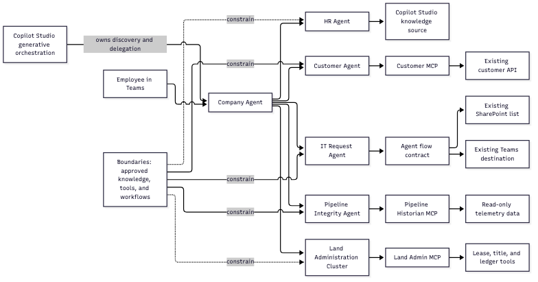

# Company Agent architecture reference

This repository is a small reference solution for composing bounded Copilot
Studio agents around existing applications and deterministic workflows.



## Composition boundary

- **Company Agent** is the employee-facing front door. Copilot Studio owns
  agent discovery, delegation, and conversation orchestration.
- **HR Agent** answers general policy questions from approved Copilot Studio
  knowledge. It does not access employee records or make employment decisions.
- **Customer Agent** uses the read-only Customer MCP server. The MCP server
  calls the existing customer API and reports only the fields that API returns.
- **IT Request Agent** gathers `employeeName`, `requestType`, `description`,
  and `isUrgent`, then calls the approved Agent flow. The flow reuses the
  existing SharePoint list and Teams destination.
- **Pipeline Integrity Agent** uses the Pipeline Historian MCP server for
  read-only telemetry and sequential compliance screening.
- **Land Administration Cluster** uses the Land Admin MCP server for lease
  extraction, title review, and confirmed ledger posting.

## Repository contracts

The repository is the source of truth for local agent and workflow contracts.

| Boundary | Contract or implementation | Result |
| --- | --- | --- |
| Front door | `agents/company-agent/agent.yaml` | Native Copilot Studio delegation |
| HR | `agents/hr-agent/agent.yaml` | Approved policy guidance |
| Customer | `agents/customer-agent/agent.yaml`, `customer_mcp/server.py` | Read-only customer lookup |
| IT request | `agents/it-request-agent/agent.yaml`, `it-request-workflow/agent-flow.contract.json` | Service Request ID and status |
| Pipeline | `agents/pipeline-integrity/agent.yaml`, `pipeline_historian_mcp/` | Observed telemetry and screening result |
| Land administration | `agents/land-admin/agent.yaml`, `land_admin_mcp/` | Extracted facts and confirmed ledger result |

## Workflow boundary

The IT Agent flow is an agent-callable entry point to the existing business
process. It does not replace the Forms-triggered flow.

```text
Agent inputs
  -> normalize and validate
  -> SharePoint Create item in the existing list
  -> SharePoint Update item with SR-###
  -> Teams Post card to the existing destination
  -> serviceRequestId, status, and result
```

The flow must return the observed Service Request ID and status before the
agent reports that the request succeeded. The flow must not create a new
Forms flow, SharePoint list, Teams team, or replacement workflow.

## Data and authority boundaries

- Approved HR knowledge is authoritative for general policy guidance.
- The existing customer API is authoritative for customer lookup results.
- MCP tools expose narrow, read-only or explicitly confirmed operations.
- The existing SharePoint and Teams process remains authoritative for IT
  request creation and notification.
- Pipeline and land-admin results remain tool-backed observations. Compliance,
  title, ownership, and approval decisions remain with qualified humans.
- PAC workspaces and tenant deployment artifacts are local outputs. They are
  not repository source files.

## What this reference does not add

This architecture does not add a repository-side router, a central
orchestration API, a generalized department framework, or unrestricted
database access. It keeps discovery and delegation in Copilot Studio and
keeps deterministic workflows and existing APIs authoritative.
