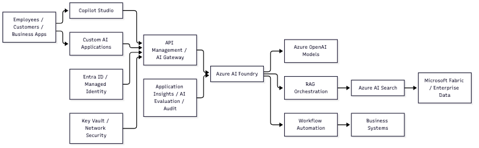

# Enterprise AI Architecture Reference

The role describes a **production enterprise AI platform**, not a single chatbot.

## How the Pieces Fit

- **Copilot Studio** provides governed conversational experiences, agent authoring, and low-code workflow automation.
- **Microsoft Foundry** is a complementary engineering and operations platform for custom code-based agents, model management, testing, evaluation, tracing, deployment, and lifecycle governance. It is not required for agents authored in Copilot Studio.
- **Azure OpenAI** supplies language, reasoning, embedding, and possibly multimodal models.
- **RAG solutions** retrieve approved enterprise knowledge before generating answers. Azure AI Search would typically provide indexing, hybrid or vector search, filtering, and citations.
- **Microsoft Fabric** provides the data foundation: lakehouse data, warehouse data, pipelines, semantic models, and analytics.
- **Workflow automation** connects agents to systems such as CRM, ERP, ticketing, HR, or field operations platforms. Agents should call controlled APIs and tools rather than receive unrestricted database access.
- **API Management or an AI gateway** centralizes authentication, rate limits, logging, prompt and model controls, content filtering, and cost management.
- **Entra ID, managed identities, Key Vault, private networking, and RBAC** provide identity and security boundaries.
- **Application Insights, platform evaluations, audit logs, and dashboards** monitor quality, latency, failures, token usage, security events, and business outcomes. Foundry evaluations are especially relevant when custom Foundry agents or model workflows are part of the solution.
- **CI/CD and governance** move agents and prompts through development, evaluation, approval, and production with versioning and rollback.

## Managerial Architecture Responsibility

The manager's responsibility is to make this platform reliable at enterprise scale:

- Define reusable patterns for agents, RAG, tools, workflows, and integrations.
- Establish security, compliance, responsible-AI, and data-access controls.
- Ensure retrieval is permission-aware and answers are grounded in approved sources.
- Create engineering standards for testing, evaluation, observability, deployment, and rollback.
- Lead teams that deliver agents across multiple business workflows.
- Connect the technical roadmap to business value, adoption, operating ownership, and delivery feasibility.

## Interview Framing

A concise way to explain the architecture is:

> I see this as a governed enterprise AI platform. I built the agents in Copilot Studio because it was the right platform for governed conversational experiences and workflow automation. Microsoft Foundry is the complementary engineering platform for scenarios requiring custom orchestration, deeper evaluation, tracing, or advanced model operations. Azure OpenAI provides the models, Azure AI Search grounds responses in approved knowledge, and Fabric supplies the enterprise data foundation. API, identity, security, evaluation, and observability layers make the solutions production-ready. The manager's job is to choose the right platform and turn these capabilities into repeatable engineering patterns and business workflows rather than isolated prototypes.

This is an inferred reference architecture based on the role description. The position may use different Azure services or have some layers already established.
